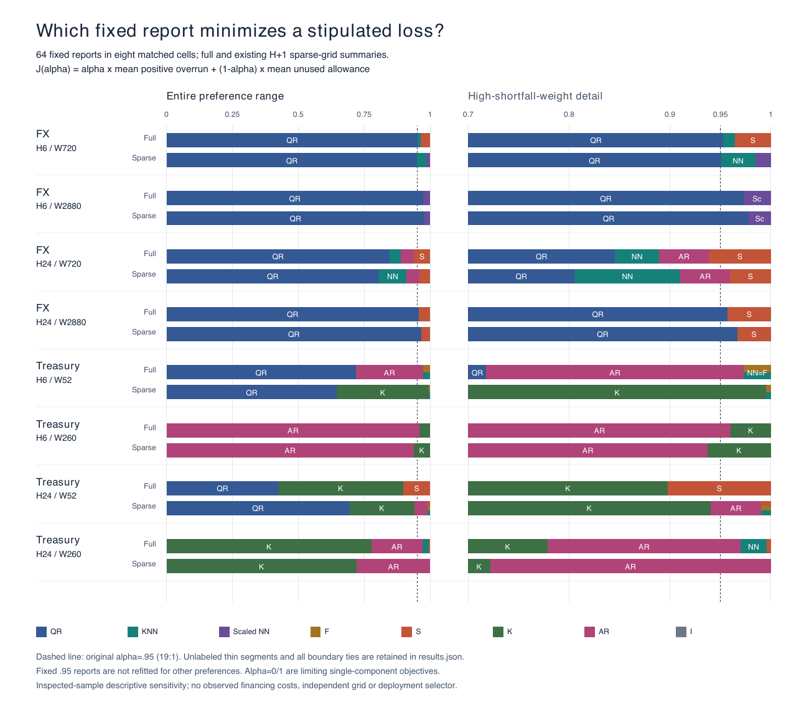

# Complete fixed-report preference robustness

This supplement asks how comparisons of **fixed, previously issued .95 reports** depend on a stipulated relative penalty for shortfall and excess. It adds Section 9 / Table 6 and Appendix E / Tables E1-E2 to the [25-page working paper](../../../manuscript/working-paper/paper.pdf). It fits no model, reads no source observations and changes no original primary or result table.



The [vector figure](preference-frontiers.pdf) shows the entire preference range and high-shortfall-weight detail. Full/sparse bars use the exact same eight-report family within each cell. Narrow segments without labels and every boundary/endpoint tie remain in the exact results.

## Four named comparisons

Let U be mean positive overrun, V mean unused allowance and J(a)=a U+(1-a)V. For 0<a<1 the shortfall/excess ratio is r=a/(1-a); the original a=.95 means r=19. Endpoints a=0/1 are limiting single-component objectives.

| Fixed left-minus-right comparison | Conclusion from both components |
|---|---|
| FX H6 QR W2880 minus original rolling F W720 | U and V both decrease: preferable for every nonnegative linear weighting, despite more strict breaches. |
| FX H6 QR W2880 minus matched frozen F W2880 | U and V both decrease under the same comparison scope. |
| FX H24 QR W2880 minus original rolling S W720 | U increases and V decreases; its 1.829% gain at 19:1 reverses above **r=20.6308977263**, a=0.953769833659. |
| Treasury H6 QR W260 minus frozen F W260 | U increases and V decreases; QR is preferable only below **r=2.86142865735**, a=0.741028492629. The adverse primary at 19:1 remains. |

Equality holds at an exact finite crossing, before displayed rounding. These comparisons use saved unrounded component means, not rounded manuscript subtraction or a new reconstruction of per-origin paired losses. Their definitions and original score/breach statistics remain intact.

## Complete family and sensitivity

Each source/H/W cell includes QR, KNN, SCALED_KNN, frozen F/S/K, AR1_REPLAY and I: 64 full-origin reports and the same 64 on the already fixed H+1 sparse grids. Each within-cell family shares the completed-label history length and refit schedule. Rolling/one-state reports do not enter the frontier; the distinct original primary references are separately named above. Sources, horizons and native monetary units are not pooled.

All **16 groups, 128 report summaries, 448 unordered pairs, 45 maximal open frontier intervals and 61 endpoint/change points** are retained in [results.json](results.json). The record includes original decimal mean tokens, breach counts, exact rational boundaries, every tie, all coefficientwise dominated reports and the .95 winner. Appendix E displays every full/sparse frontier and the exactness/rounding convention.

At .95 the preferred report changes in four cells on the sparse grid: FX H24 W720; Treasury H6 W52 and W260; Treasury H24 W52. FX sparse counts are 947/265 and Treasury counts 40/12 for H6/H24. Disjoint label windows still share training histories and do not imply independence or a new sample. The full-grid Treasury H6 W260 QR is never a minimizer among the eight fixed reports, including both endpoints; that is a finite-menu descriptive result.

## Execution history and independent checks

Preliminary values were inspected before this design. The [design](../../../protocol/revision-20261022/preference-robustness-design.md) and [original execution freeze](../../../protocol/revision-20261022/preference-robustness-freeze-v1.json) were publicly verified at [befd017](https://github.com/ByronLi0207/financial-mathematics-paper-20261020/commit/befd01798ca2669f5b9b12874290c5b5ed0134eb) before the first complete run. This is execution identity, not statistical preregistration or restored unseen validation.

Independent review identified a checker gap: headline comparison labels and copied score/breach fields were not all checked. The corrected verifier and synthetic corruption tests were bound by [revision 2](../../../protocol/revision-20261022/preference-robustness-freeze.json), publicly verified at [93a256a](https://github.com/ByronLi0207/financial-mathematics-paper-20261020/commit/93a256a2e136dd5f68672c774667f94bb4abb63b) before a second complete run. Both mathematical result JSON files are byte-identical. The [v1 receipt](independent-verification-v1.json) and both [v1](public-freeze-verification.json) / [v2](public-freeze-verification-v2.json) public-byte records are retained. The [current independent receipt](independent-verification.json) covers the strengthened checker.

The producer uses all pairwise exact crossings and midpoint winners. The independent checker instead intersects affine inequalities to find each method's complete feasible optimality interval. It validates source tokens, full inventory, every pair, region, point-only winner and .95 winner, plus every named comparison's complete identity/statistics. Both use Fraction on saved decimal tokens; these tokens summarize floating-point financial calculations. Exact rational output is not an infinite-precision assertion about the underlying sample or financial costs.

The current full repository suite passes **563 tests** (original 526 plus 37 new scoped tests). A fresh review also checked 2,000 random synthetic families by both independent algorithms. The [resource observations](resources.json) distinguish the two calculations/readbacks; neither research hours nor continuous thread maxima are inferred. The original 69-file read-only result archive also passes verification.

## Reproduce without raw data

Use Python 3.10+; the actual checks used the existing bundled Python 3.12 environment. No package installation is needed for the standard-library analysis or verifier. From a complete checkout:

```bash
python3 -B build_preference_results.py --output .scratch/preference-NEW_ID
python3 -B verify_preference_frontier.py --result .scratch/preference-NEW_ID/results.json --output .scratch/preference-NEW_ID/independent-verification.json
```

The destination and receipt must be new. The producer verifies the complete current input/executable freeze before and after calculation; the checker independently binds the same six tables and result bytes. To render the supplementary vector figure with the existing ReportLab dependency:

```bash
python3 -B build_preference_figure.py --result .scratch/preference-NEW_ID/results.json --output .scratch/preference-frontiers-NEW_ID.pdf
```

## Interpretation

Varying a reweights fixed actions. It does not turn their .95 fits into estimates of other quantiles, establish dominance over all consistent .95 scoring functions, or implement a Murphy diagram. No financing prices, cash deficits or decision interventions are observed. An inspected lower envelope is a hindsight description, not an executable deployment selector. Original source-vintage, measurement, overlapping-label, family-selection, missing compatible unseen validation and financial-policy limitations continue to apply. Linear-envelope arithmetic is elementary; the contribution is an additional application/model-validation finding, with no new-estimator or journal-tier claim.
